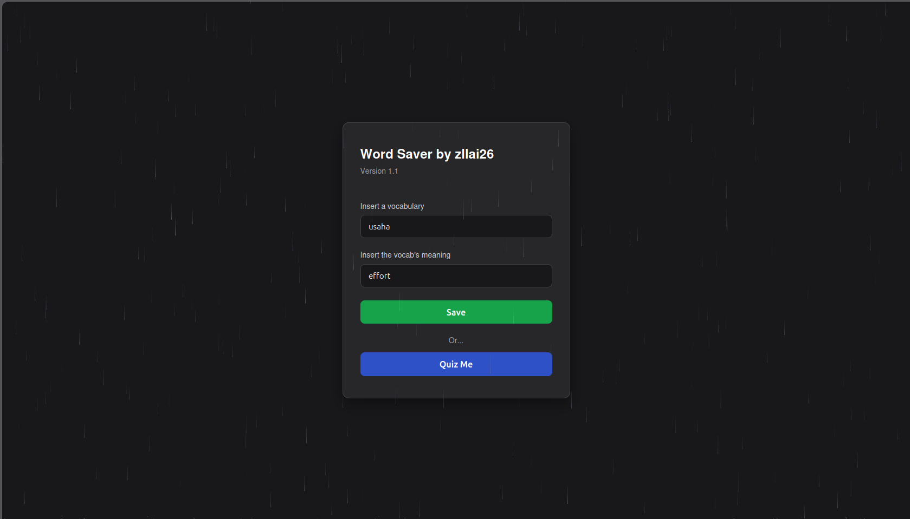
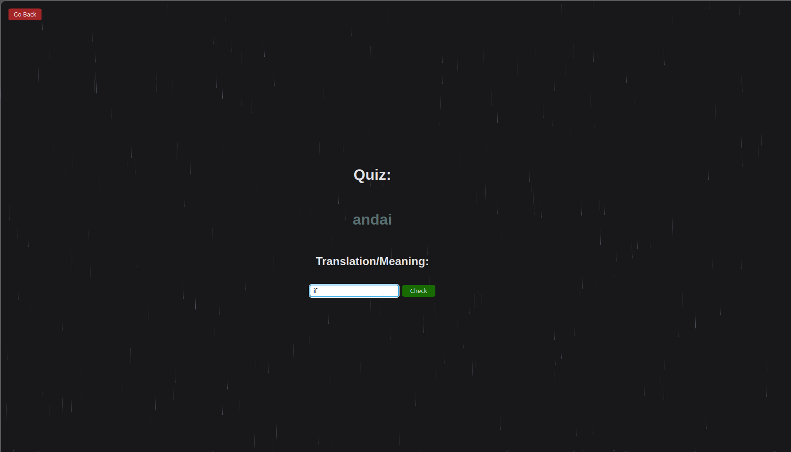

# Hafalkan

A word saver program that save and retrieve words from a database





## Features

- **Each user have their own account** so it won't mess things up
- **Save words** from your account and won't mess up to other people's account
- **Quizzes** picked directly from your word bank and won't mess up to other people's word bank.
- Runs entirely in your browser

## Try it

**[Open jsTimer](https://hafalkan.lab26.my)**

## Run locally

```bash
git clone https://github.com/zllai26/hafalkan.git
cd hafalkan
```

Then open `public/index.html` in your browser. No build step or dependencies needed.

## Contributing and issues

Found a bug or have an idea? You can:

- Open an issue in the [Issues](https://github.com/zllai26/hafalkan/issues) tab
- Submit a pull request to the `main` branch
- Contact me via [my homepage](https://github.com/zllai26)

## License

Released under the [GPL-3.0 license](LICENSE).
